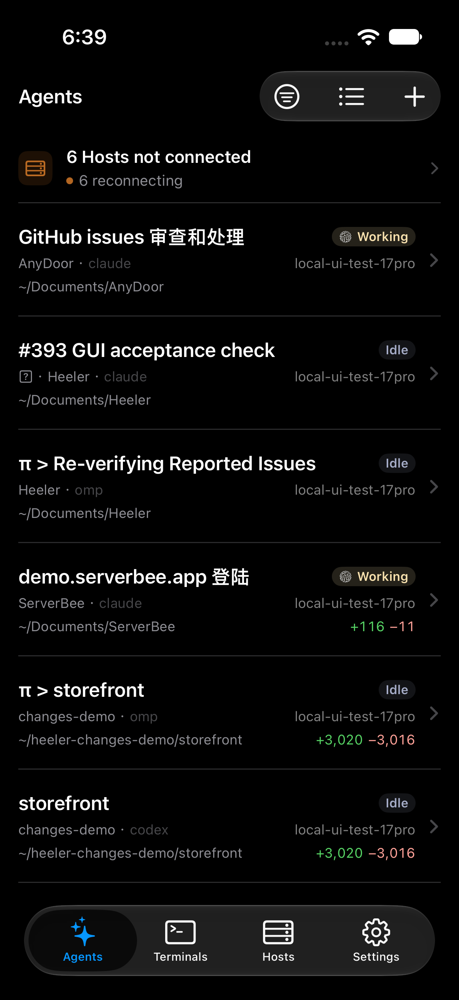
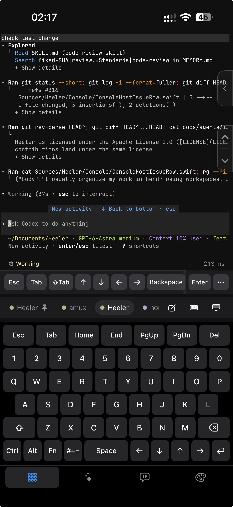
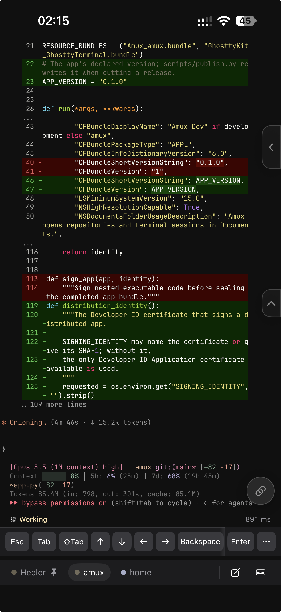
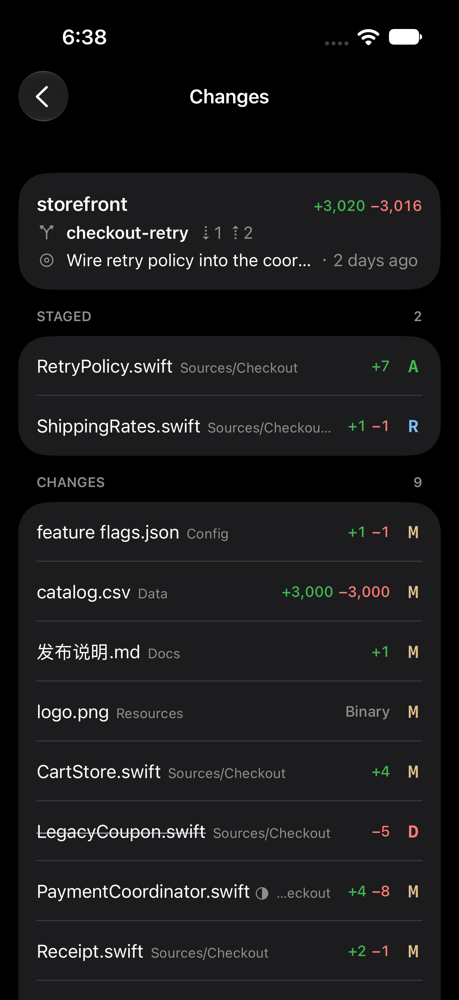
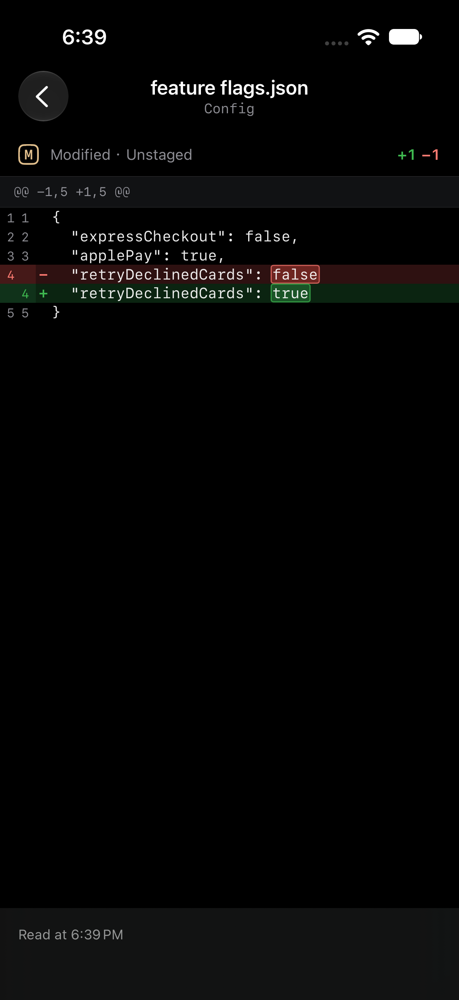
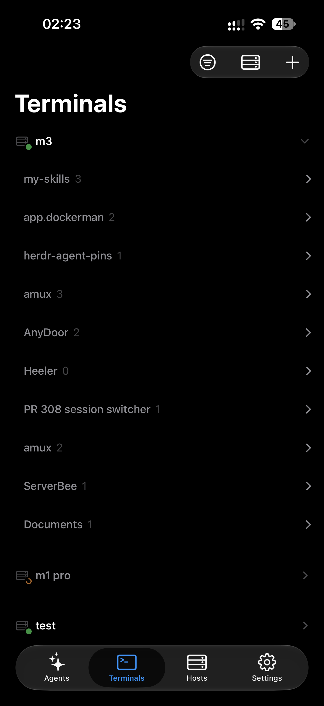
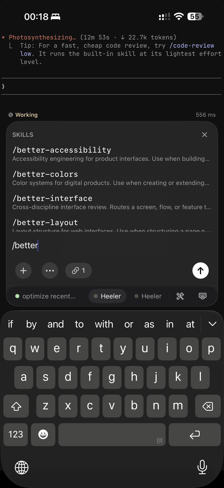
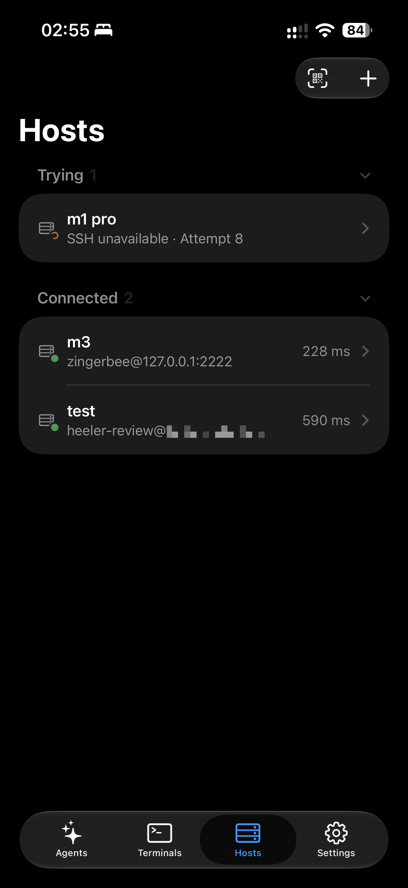
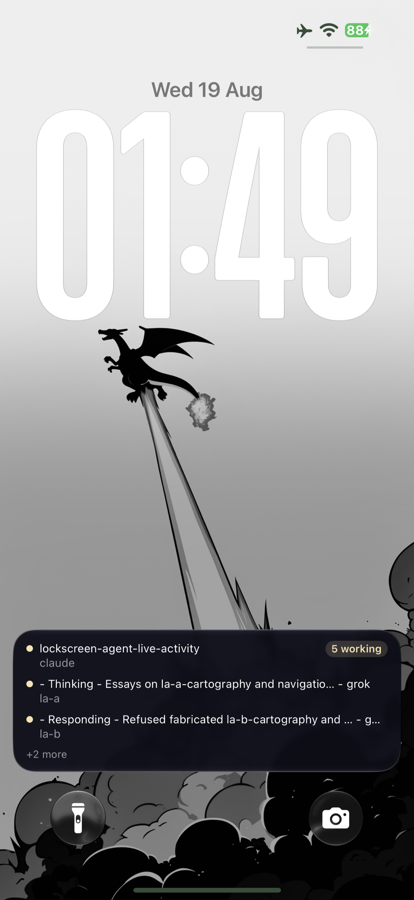
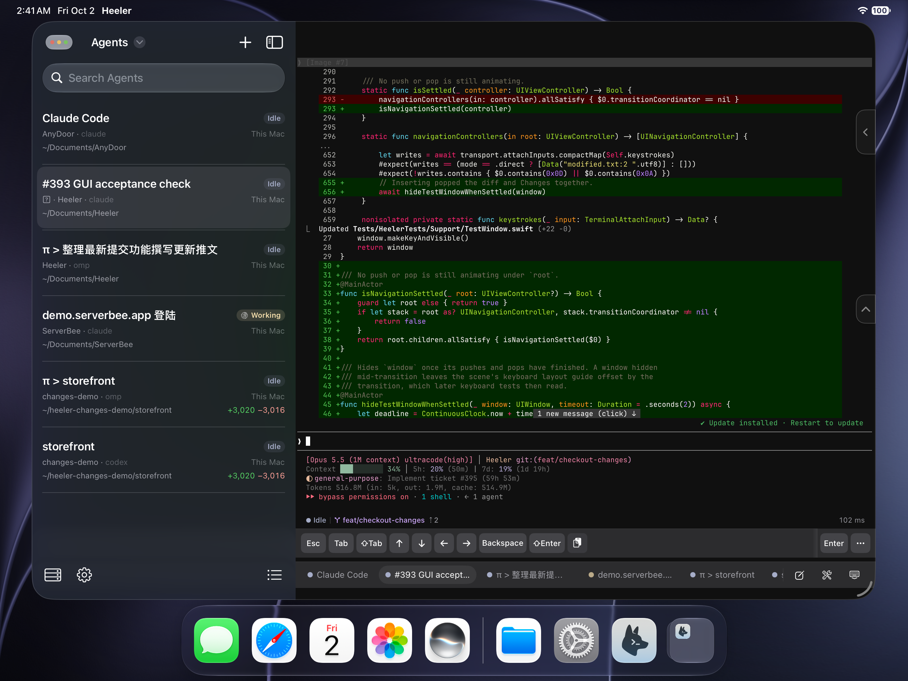

<div align="center">


# Mercurio

**Ormus Solutions' iOS companion for [herdr](https://herdr.dev).** Not on the App Store or TestFlight.

[](LICENSE)
[](https://www.swift.org)
[](https://developer.apple.com/ios/)

English | [简体中文](./README-zh.md)

</div>

---

Mercurio is an **agent console**: a native dashboard of every coding agent running on your machines, sorted by who needs you. Open an Agent to read and steer its live terminal, draft with the full iOS keyboard in a native Composer, and Send the complete message once — all over plain SSH.

## Screenshots

| Agent Console | Direct Input + Terminal keyboard | Live terminal |
| --- | --- | --- |
|  |  |  |

| Changes | File diff | Terminals |
| --- | --- | --- |
|  |  |  |

| Skills | Hosts | Live Activity |
| --- | --- | --- |
|  |  |  |

<a href="docs/ipad-screenshots.md"></a>

[View iPad screenshots](docs/ipad-screenshots.md)

## Features

- **Console** — every Agent on every machine in one status-sorted list
  (Blocked first), filterable by Host, updated live.
- **Attach** — the Agent's real terminal rendered by libghostty: native
  scrollback, momentum touch scrolling that also drives full-screen TUIs,
  long-press selection, takeover of a stale terminal owner, and quietly
  collected web links to open later.
- **Composer** — draft locally with the full iOS keyboard (autocorrect, IME,
  dictation), then Send once; the tools keyboard adds Agent control keys,
  Agent Skills, reusable Snippets, and terminal appearance.
- **Terminal** — open a plain shell in the Agent's directory, with Text and
  Keys modes and one reused tab per Workspace.
- **Attachments** — stage a photo or a file up to 64 MiB onto the Host over
  SFTP and insert its path into the draft.
- **QR pairing** — scan a Pairing Code to add a machine; keys are generated
  on device, private keys stay in the Keychain, and the code pins the host
  key fingerprint.
- **Notifications + Live Activities** — end-to-end encrypted pushes when an
  Agent goes Blocked or Done, and a lock-screen / Dynamic Island banner
  tracking Agents in real time; the relay can never read the content
  ([PRIVACY.md](PRIVACY.md)).
- **Worktrees** — start an Agent on a clean checkout of the workspace's repo.
- **Appearance** — System, Light, or Dark; 30 terminal themes with separate
  Light and Dark slots; bundled JetBrains Mono and IBM Plex Mono; pinch to
  zoom.
- **Jump Host** — reach unroutable machines through an SSH jump, with keys
  verified at both hops.

## How it connects

On macOS and Linux Hosts, Mercurio speaks herdr's JSON API over SSH: each request opens a
direct-streamlocal channel onto `herdr.sock`, one long-lived channel carries
the event stream, and interactive terminals run `herdr agent attach
--takeover` on an SSH PTY. The only prerequisites are SSH access and a
running herdr — no server changes, no extra packages. The SSH server must
allow stream-local forwarding (the OpenSSH default); onboarding calls it out
when it's disabled.

Native Windows Hosts (herdr >= 0.9.3) connect over SSH and are added manually.

For Tailscale, ZeroTier, or EasyTier access, follow the [Overlay Network setup guides](docs/guides/overlay-networks.md). They cover macOS installation, Tailscale without a VPN on the Mac, Mercurio configuration, and connection checks. Mercurio joins these networks inside the app without an iOS VPN configuration; you need a Mercurio version with **Settings > Overlay Networks**.

[View the Mercurio setup screenshots](docs/guides/overlay-networks.md#heeler-setup-screenshots) for Tailscale, ZeroTier, and both EasyTier modes.

Unroutable machines can sit behind an SSH Jump Host:

- [Set up remote access step by step](docs/guides/vps-jump-host-setup.md)
- [Architecture, security boundaries, and the VPS runbook](docs/guides/vps-jump-host.md)

A Host can have several routes, such as its LAN address at home and an overlay network or Jump Host elsewhere: [Reach a Host on several routes](docs/guides/host-routes.md).

## Installation

Mercurio is **not on the App Store or TestFlight**. You build it from this
repository and install it on your own iPhone. (The App Store and TestFlight
listings you may find for "Heeler" install a different app, the upstream
project this one is forked from.)

### What you need

- A Mac with **Xcode** (the iOS 18 SDK or newer; the default simulator names in
  the Makefile assume Xcode 26 or newer, and the Simulator runbook was last
  observed on Xcode 27) and [XcodeGen](https://github.com/yonaskolb/XcodeGen):
  `brew install xcodegen`.
- An **Apple Developer team of your own**, with your Apple ID signed in to
  Xcode (Settings > Accounts). Apple App IDs and App Groups are unique across
  all teams, so you cannot sign the ids this repository ships; you give the
  build your own team id and your own bundle-id prefix (below). A paid Apple
  Developer Program team is the path the maintainers use. Whether a free
  personal team can sign the App Group is not verified.
- An iPhone on iOS 18 or newer, with Developer Mode on, connected by cable and
  trusted; or just the iOS Simulator.
- A machine running [herdr](https://herdr.dev/docs/install/) with SSH enabled
  (macOS or Linux: continue at "Adding a machine" below; native Windows: the
  [Windows setup guide](docs/guides/windows-setup.md)).

### Build and install

```bash
git clone https://github.com/Ormus-Solutions/mercurio-ios.git
cd mercurio-ios

# Once: your team id (Apple Developer > Membership) and a bundle-id prefix you own.
scripts/set-signing.sh ABCDE12345 com.example.mercurio

make install            # builds Debug for the connected iPhone and launches it
```

`scripts/set-signing.sh` rewrites the team and the bundle ids, the App Group and
the keychain labels in your checkout so they all agree. Keep that on a local
branch; do not send it in a pull request. Without it, `make install
TEAM=<team id>` signs with your team but keeps the shipped ids, which only
works for the maintainers' team.

Other targets: `make sim` runs it in the Simulator, `make test` runs the unit
tests on a Simulator, `make help` lists the rest. First launch of a build
signed by a developer team: on the iPhone, Settings > General > VPN & Device
Management > trust your developer certificate.

Push notifications do not work in a build you sign yourself: they need an
APNs relay of your own (see `relay/`) and a paid team. What else is missing is
in [docs/mercurio/limitations.md](docs/mercurio/limitations.md).

## Adding a machine

On a macOS or Linux machine running herdr (Node >= 20, herdr >= 0.7.5, OpenSSH server on —
macOS: **System Settings > General > Sharing > Remote Login**):

```bash
herdr plugin install Ormus-Solutions/mercurio-ios/plugin --ref main --yes
herdr plugin action invoke heeler.pair
```

Scan the Pairing Code QR it shows and the machine is added as a Host — the
code carries the addresses, the host key fingerprint, and SSH key enrollment.
The same [plugin](plugin/README.md) delivers the encrypted notifications once
you enable them for the Host in the app. For every step, the popup's keys, and
troubleshooting, see the [pairing guide](docs/guides/pairing.md).

## Native Chat

On macOS and Linux Hosts, Chat displays Claude Code, Codex, Pi and Oh My Pi conversations from their transcript files over SSH. Saved conversations remain readable while reconnecting. Chat needs the conversation reference reported by herdr to identify the correct transcript; installing the integration alone does not prove that the current Agent has reported one.

For Pi and Oh My Pi, install the corresponding `herdr integration install pi`
or `herdr integration install omp` on the Host and restart that Agent to load
its extension. Chat reads the v2/v3 JSONL file the integration reports, including
custom session directories. Messages, reasoning, tool results and compaction
boundaries use the native timeline. Custom editors and extension dialogs stay
available in the terminal. See [format and compatibility details](docs/research/pi-transcript-format.md).

### Codex shows “Waiting for Conversation”

Codex CLI 0.161.0 normally starts or reuses a shared background server for interactive sessions. With herdr 0.9.3 and Codex integration v8, that server can retain another terminal's environment. The integration can then report a conversation ID to the wrong herdr pane, leaving Chat waiting even after prompts have been sent. See the [versioned compatibility observations](docs/agents/herdr-compatibility.md#versioned-observations).

For this combination, start Codex inside the herdr pane with:

```bash
codex --no-daemon
```

To resume an existing conversation, use `codex --no-daemon resume` and select it. If you already use `--yolo`, keep it alongside the new flag: `codex --no-daemon --yolo`.

`--no-daemon` uses an independent backend with the current terminal's environment. It retains access to your existing login, configuration, and saved conversations. The shared backend supports multiple clients and remote access; the trade-off here is an additional independent backend for each CLI invocation.

This flag applies only when launching Codex. Changing a shell alias or function does not migrate an already-running session: let its work finish, exit it, then resume with the flag. Mercurio does not add this flag to your shell automatically. Cached messages can still be shown when a previously known ID is temporarily missing, but caching cannot establish an Agent's first conversation binding. For a genuinely new conversation, send its first prompt before checking again.

## Opening an Agent from another app

Another app can open an Agent in Mercurio with a link:

```text
mercurio://agent?host=my-mac&session=work&pane=w1%3Ap1
```

- `host` names a saved Host on that session: its address, or its name when
  no Host on the session has that address. Case is ignored.
- `session` is the herdr session name. Leave it out, or pass `default`, for
  the default session.
- `pane` is herdr's pane id. Leave it out to open the Console.

Percent-encode each value, with `%20` for a space: a `+` stays a plus sign,
so form encoding (such as JavaScript's `URLSearchParams`) misses a name like
`Build Box`. When no saved Host on that session matches, or more than one
does, the link opens the Console.

## Stack

- SwiftUI, iOS 18+, iPhone and iPad. iPad support is restored in 0.1.8 with Magic Keyboard shortcuts, multiwindow, and drag and drop.
- The repository-local `Packages/HeelerSSH` (libssh2 + OpenSSL) for SSH
- [libghostty-spm](https://github.com/lakr233/libghostty-spm) for terminal emulation and Metal rendering

See `docs/adr/` for why — the transport story in particular is not obvious.

## Contributing

Issues and PRs are welcome — see [CONTRIBUTING.md](CONTRIBUTING.md) for
layout, build/test, and conventions.

## Status

This release was prepared and scanned on Linux. The build steps in
"Installation" have not yet been run on a Mac for this exact tree: there was
no Xcode where it was prepared, so `make install`, `make test` and
`scripts/set-signing.sh` on a real project are untested. If you build it,
please report the result, working or not, as an issue on this repository,
with your Xcode version and the command that failed.

## Credit and license

Mercurio for iOS is a modified fork of [Heeler](https://github.com/ZingerLittleBee/Heeler)
by ZingerLittleBee, which does almost all of the work you see here. Both are
licensed under the [Apache License 2.0](LICENSE). [NOTICE](NOTICE) records
that Mercurio modifies Heeler, [CHANGELOG.md](CHANGELOG.md) lists the releases,
and the
third-party notices under `Sources/Heeler/Resources/Notices` stay in place.
The module and plugin names still say Heeler so that upstream releases can be
merged. This is not an official Heeler release and is not endorsed by its
maintainers.

An Ormus Solutions app. Not affiliated with the herdr project.
